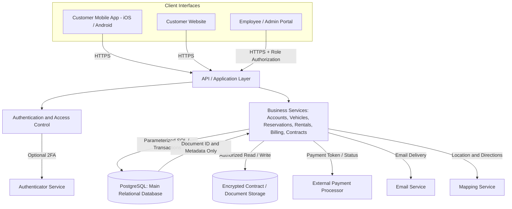

# BeAvis Car Rental System
Nathan Brady, Daniel Cruz, Abdul Rahim Karimi, Abdulwahab fazli, Mohammad Rasooli, Abdullah Mohammed, Mohammed Kashif

## System Description
The BeAvis Car Rental System is a software platform for managing the company’s car rental operations. Customers can access it through a mobile app for iOS or Android, or through a website. Both channels allow customers to create and verify an account, sign in, find nearby rental locations, make and manage rentals, view rental history, and manage payment methods. Customers may also enable two-step authentication in their account settings.
Employees can sign in to review customer rental status and contracts, check vehicle availability, and update vehicle status when a car needs maintenance. The system supports rental agreement distribution and electronic signing, and stores signed contracts securely.
The system uses location services to help customers find nearby branches and get directions. It also integrates with email, mapping, payment, and authenticator services. Payment information and signed contracts receive restricted handling to protect sensitive customer data.

## Software Architecture Overview
### UML Use Case Diagram

### UML Class Diagram:

#### Description:
This UML class diagram describes a car rental system and the main data and operations it supports.

The Users class holds shared account details and provides login, logout, and profile-update functions. Customer, Employee, and Administrator represent different user roles. Customers can search available vehicles, make or cancel reservations, and view rental history. Employees check vehicles out and in, recording details such as mileage, fuel, and damage. Administrators manage vehicles and branches and generate reports.

The system tracks its rental process through several related classes:

Branch represents a rental location and provides vehicle availability information.
Vehicle stores details such as make, model, category, mileage, daily rate, and status.
Reservation records the customer, selected vehicle, pickup and return branches, dates, status, and estimated cost.
Rental records the actual vehicle checkout and return, including mileage and fuel details.
Payment tracks charges or refunds and their status.
Invoice calculates the rental’s charges, fees, taxes, and total.
Notification represents messages such as confirmations, reminders, and receipts.
Extra represents optional add-ons with their own daily prices.
Report summarizes rental activity and revenue over a date range.
The Enumerations section lists allowed values for roles, vehicle categories and statuses, reservation and rental statuses, payment methods and statuses, and notification types. These values help keep system records consistent.

Overall, the diagram shows how customer accounts, reservations, vehicles, rentals, payments, and supporting records fit together to support the company’s rental workflow. The connection lines indicate relationships between classes; where the diagram does not show quantities, it does not specify exactly how many records can be associated.

### SWA Diagram

#### Description:

### UML Class Description:
This software architecture shows how a car rental system works. Customers use the mobile app or website, while employees use a staff portal with role-based access. Their requests go to the API/application layer, which handles login, accounts, rentals, vehicles, locations, and contracts. The system stores regular information, such as customer, employee, vehicle, and rental data, in the core data stores, while more sensitive information, such as payment references and encrypted contracts, is kept in protected storage. The security and integration layer connects the system to outside services like payment processors, email services, maps, and authenticator apps. The arrows show how information moves securely between each part of the system using HTTPS, TLS, authentication, and limited access permissions.

## Updated Software Architecture Diagram (Database-Aware Design)

The following diagram updates the existing software architecture with the proposed data management design. It keeps the existing mobile/web clients, employee portal, application layer, external integrations, and separate handling of protected information.

**Diagram explanation:** 
Customer and staff requests reach the API over HTTPS. Authentication and role permissions are checked before the business services read or modify data. PostgreSQL stores structured operational records and references to signed contracts. Signed contract files are stored separately in encrypted, access-controlled document storage. The payment processor handles card details; BeAvis retains only necessary payment references and statuses. External email, mapping, and authenticator services remain integrations rather than internal databases. This is a **proposed updated architecture** for group approval, not a claim that the system has already been implemented.

## Data Management Strategy
 
### 1. Database Technology and Rationale

We propose **PostgreSQL (SQL relational database)** for BeAvis because its core information is structured and connected: customers make reservations for vehicles at branches; employees check vehicles out and in; rentals produce invoices and payment records. Foreign keys help maintain valid links, and transactions help prevent partial updates. SQL queries also support searches by vehicle, branch, date, and rental status.

### 2. Number of Databases and Storage Systems

The design uses **one primary PostgreSQL database** for operational data and **one separate encrypted document-storage system** for signed agreements. Document storage is a storage service, not a second SQL database. A third-party payment processor is an external service, not a BeAvis database. This keeps the relational design manageable while giving signed contracts distinct access and retention controls.

### 3. Logical Data Organization

| Table / Store | Key fields or contents | Purpose / Relationships |
| --- | --- | --- |
| Users | user_id (PK), name, email, role, authentication reference | Shared accounts; roles include customer, employee, administrator |
| Branches | branch_id (PK), name, address, location | Pickup/return locations |
| Vehicles | vehicle_id (PK), branch_id (FK), make, model, category, daily_rate, mileage, status | Each vehicle is assigned to a branch |
| Reservations | reservation_id (PK), customer_id (FK), vehicle_id (FK), pickup_branch_id (FK), return_branch_id (FK), pickup_at, return_at, status, estimated_cost | Tracks requested and confirmed rentals |
| Rentals | rental_id (PK), reservation_id (FK), employee_id (FK), checkout_mileage, return_mileage, checkout_fuel, return_fuel, actual_return_at, status | Tracks actual checkout and return |
| Extras | extra_id (PK), name, daily_price | Catalog of optional add-ons |
| Reservation_Extras | reservation_id (FK), extra_id (FK), quantity | Connects reservations with selected extras |
| Invoices | invoice_id (PK), rental_id (FK), subtotal, fees, tax, total | Final billing summary |
| Payments | payment_id (PK), invoice_id (FK), processor_reference, amount, method_type, status | Tracks charges/refunds without storing full card numbers |
| Notifications | notification_id (PK), user_id (FK), type, sent_at, status | Tracks confirmations, reminders, receipts |
| Contracts | contract_id (PK), reservation_id (FK), storage_key, signed_at, document_status | Stores metadata and a reference to protected document storage |
| Encrypted document storage | Signed agreement files | Files are encrypted and accessible only through authorized application functions |

PK means primary key; FK means foreign key. Fields are illustrative and can be refined during implementation. Roles and status fields should use defined allowed values matching the UML enumerations.

### 4. How the Data Moves Through the System

**Vehicle search and reservation:** The customer enters a branch and rental dates. The application queries eligible vehicles and checks for overlapping confirmed or active reservations. When the customer confirms, the server validates the dates and availability again and saves the reservation in a transaction. A vehicle must not receive two confirmed reservations for overlapping periods. A vehicle's general status alone is not enough to determine date-specific availability.

**Checkout:** An employee accesses a confirmed reservation, verifies the vehicle and customer, and records starting mileage and fuel. The system creates a rental record and updates the reservation and vehicle statuses in a transaction. Invalid or cancelled reservations cannot be checked out.

**Return and billing:** An employee records return mileage, fuel, time, and any applicable damage. The application calculates charges, creates or updates the invoice, records payment status through the payment provider, and updates the rental and vehicle status. A vehicle needing maintenance should be marked unavailable rather than automatically made rentable.

**Contracts and notifications:** The application stores a signed contract file in encrypted document storage, while the SQL database stores the file reference, ownership, signing time, and status. Notifications can be sent by email and their delivery status recorded in SQL.

### 5. Data Consistency, Security, and Recovery

- **Consistency:** Use foreign keys, required-field validation, unique identifiers, and database transactions. Recheck availability at confirmation and coordinate concurrent reservations so two customers cannot book the same vehicle for overlapping dates.
- **Access control:** Customers may access only their own reservations and contracts; employees see information needed for their work; administrators have separately controlled permissions. Enforce these checks on the server, not only in the app interface.
- **Sensitive information:** Encrypt database connections and stored contract files. Store password hashes through a trusted authentication system, not plaintext passwords. Do not store complete card numbers or card security codes; use payment-provider tokens/references instead.
- **Auditability:** Log important reservation changes, checkouts, returns, payment events, and access to sensitive contracts without putting secrets in logs.
- **Backups and retention:** Schedule encrypted database backups, test restoration, restrict backup access, and establish retention/deletion rules for customer information and signed contracts according to applicable requirements.

These are design requirements for implementation; they are not statements that security controls or backups are already operating.

## Verification Test Plan
### Test Plan 1: Make a Reservation
Objective: Verify that customers can find an available vehicle, create a reservation, and receive an accurate estimate.

Test data: A vehicle is available at Branch A from June 10–15. A second reservation overlaps June 12–14.

| ID | Granulaty | Test scenario and steps | Expected result |
| --- | --- | --- | --- |
| R-UNIT-01 | Unit | Test the availability calculation with a vehicle that has no reservation during the requested dates | The vehicle is returned as available |
| R-UNIT-02 | Unit | Test the availability calculation with a vehicle that has an overlapping confirmed reservation | The vehicle is returned as unavailable for the overlapping dates |
| R-UNIT-03 | Unit | Calculate an estimate for a five-day reservation with a daily rate and one paid extra | The estimate equals the daily rate multiplied by five, plus the extra’s five-day price |
| R-UNIT-04 | Unit | Submit a reservation with a return date before the pickup date | Validation rejects the dates and creates no reservation |
| R-INT-01 | Integration | Search for an available vehicle using pickup and return dates, then create a reservation for one of the vehicles returned by the search. | The reservation is made and stored, and that vehicle is no longer available for those reservation dates. |
| R-INT-02 | Integration | Search for an available vehicle, then create a reservation with dates that overlap with another registration for that same vehicle. | The reservation is not completed due to the overlapping reservation dates, and the user is prompted to enter a new reservation date. |
| R-INT-03 | Integration | Create a reservation with a vehicle, select reservation dates, and then change the reserved vehicle to a new vehicle that is available during those dates. | The vehicle being reserved is swapped, with all the applicable info remaining the same and the price being updated for the new vehicle. |
| R-SYS-01 | System | Sign in as a customer, search for a vehicle, select dates and branches, review the estimate, and confirm the reservation. | The system creates a confirmed reservation, displays its details, and shows it in rental history. |
| R-SYS-02 | System | Attempt to reserve a vehicle that became unavailable after the search results were displayed. | The system prevents confirmation and explains that the vehicle is no longer available. |
| R-SYS-03 | System | Submit a reservation with invalid dates or missing required information. | The system identifies the invalid or missing fields and does not create a reservation. |
### Test Plan 2: Vehicle Checkout and Return
Objective: Verify that an employee can check out a vehicle for a confirmed reservation and complete the rental on return.

Test data: A confirmed reservation exists for a customer and vehicle. The vehicle is available at the pickup branch. Record odometer and fuel values at checkout and return.

| ID  | Granulaty | Test scenario and steps  | Expected result |
| --- | --- | --- | --- |
| C-UNIT-01 | Unit | Start a rental using a valid confirmed reservation and valid checkout mileage and fuel values. | A rental record is created and linked to the reservation, employee, and vehicle. |
| C-UNIT-02 | Unit | Submit checkout mileage lower than the vehicle's stored mileage. | Validation rejects the mileage and does not start the rental. |
| C-UNIT-03 | Unit | Calculate distance driven from checkout and return mileage. | The result equals return mileage minus checkout mileage. |
| C-UNIT-04 | Unit | Calculate a late fee when the vehicle is returned after the scheduled return time. | The fee matches the configured late-fee rules; an on-time return produces no late fee. |
| C-INT-01 | Integration | Check out a vehicle for a confirmed reservation. | The system creates the rental, updates the reservation status, records checkout details, and marks the vehicle as rented. |
| C-INT-02 | Integration | Try to check out a vehicle for a cancelled reservation. | Checkout is rejected; no rental is created, and the vehicle status is unchanged. |
| C-INT-03 | Integration | Complete a return with mileage and fuel details. | The system completes the rental, updates vehicle mileage and status, and calculates the final charges. |
| C-INT-04 | Integration | Complete a return with a late fee or damage charge. | The invoice includes the applicable charge, and the payment record reflects the resulting amount and status. |
| C-SYS-01 | System | Sign in as an employee, locate a customer's confirmed reservation, record checkout mileage and fuel level, and complete vehicle checkout. | The rental is started, the reservation status changes to active, and the vehicle status changes to rented. |
| C-SYS-02 | System | Attempt to check out a vehicle using a cancelled or invalid reservation. | using a cancelled or invalid reservation.The system prevents checkout, displays an error message, and creates no rental record. |
| C-SYS-03 | System | Process a vehicle return by entering return mileage and fuel level for an on-time rental | The rental is closed, final charges are calculated, the vehicle status changes to available, and an invoice is generated and sent to the customer. |
| C-SYS-04 | System | Process a vehicle return that is late and includes a damage charge, then collect payment. | The invoice includes all applicable fees, payment is recorded successfully, and the rental is marked complete. |

## Development Plan and Timeline
### 10/1/2026
#### UML Use Case Diagram
Nathan Brady, 
Daniel Cruz

#### UML Class Diagram
Abdullah Mohammed,
Mohammad Rasooli,
Mohammed Kashif

#### SWA Diagram
Abdul Rahim Karimi 

#### SWA Description
Abdulwahab Fazli

### 10/15/2026

### 10/29/2026
#### Updated Software Architecture
Daniel Cruz

#### Database Technology and Rationale
Mohammed Kashif

#### Number of Databases and Storage System
Abdul Rahim Karimi 

#### Logical Data Organization
Mohammad Rasooli

#### How Data Moves Through The System
Nathan Brady

#### Data Consistency, Security, and Recovery
Nathan Brady
